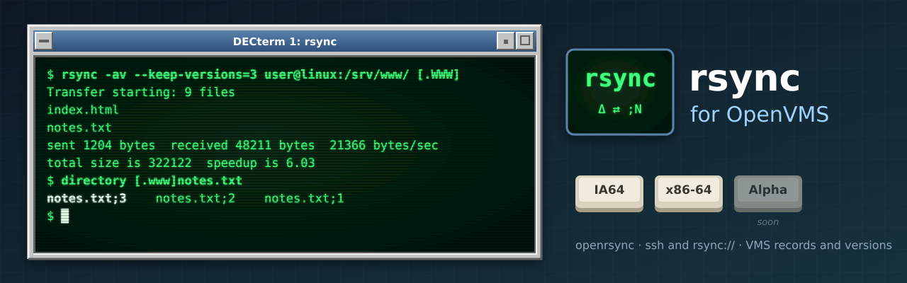

<p align="center">
  
</p>

# vms-rsync

[](https://github.com/issinoho/vms-rsync/releases/latest)
[](https://github.com/issinoho/vms-rsync/releases)

[](https://github.com/kristapsdz/openrsync/blob/master/LICENSE.md)

rsync for OpenVMS (x86-64 and IA64), ported from [openrsync](https://github.com/kristapsdz/openrsync),
the ISC-licensed rsync that OpenBSD and macOS ship. It keeps a VMS directory tree and
another system's in step, sending only what changed, over ssh or from an `rsync://`
server, and it copies VMS to VMS. Part of the
[ports and tools for OpenVMS](https://openvms.issinoho.com) family.

**Status: early test (PCSI T0.1-1).** Tested on both architectures against rsync 3.4.1
on Linux, every file checked by MD5. Please report problems in the
[issues](https://github.com/issinoho/vms-rsync/issues).

    $ rsync -av [.WWW] user@linuxhost:/srv/www/          ! push over ssh
    $ rsync -av user@linuxhost:/srv/www/ [.WWW]          ! pull over ssh
    $ rsync -av rsync://linuxhost/module/ [.MIRROR]      ! pull from a daemon
    $ rsync -av [.SRC] [.BACKUP]                         ! local copy

## What it does on VMS

- **Text files:** variable-length record files go as LF lines, and arrive as records
  again when their file type is a text type (`RSYNC$TEXT_TYPES`, by default the same
  list as VFTP). Everything else goes byte for byte, as Stream_LF files.
- **Versions:** nothing is replaced in place; each update is a new version of the file.
  `--keep-versions=N` keeps the newest N, and `--delete` removes every version of a
  file the source no longer has.
- **Names:** VMS file specifications work as arguments (`[.DIR]`, `DISK:[DIR]`). Names
  that differ only in case are one file on VMS: the second is left out with a message,
  and the exit status is 23.
- **Attributes:** times, modes as protection, and symlinks. Files belong to the user
  running rsync (`-o`/`-g` are ignored). `-H` is refused, and devices and fifos are left
  out.
- **Options:** `-a -v -n -c -z`, `--delete`, `--partial`, `--progress`, `--link-dest`
  and the rest of openrsync's set. Options in capitals need quotes in DCL (`"-P"`), or
  `SET PROCESS/PARSE_STYLE=EXTENDED`.
- **Exit status:** a failure has error severity under DCL, so `ON ERROR` works; rsync's
  code is `($STATUS .AND. %X7F8) / 8`.

Not yet: VMS as the remote end (`rsync --server` under VSI's sshd, which does not give a
command a clean binary channel), and pushing to an `rsync://` daemon (openrsync can
only pull from one). [docs/DECISIONS.md](docs/DECISIONS.md) and
[docs/NOTES.md](docs/NOTES.md) record what was found on the way.

## Installing

The kits have no prerequisites; `-e ssh` uses VSI's OpenSSH client when it is installed.
A kit downloaded through a non-VMS system loses its record format. As SYSTEM, restore it
and install:

    $ SET FILE/ATTRIBUTE=(RFM:FIX,LRL:8192,MRS:8192,RAT:NONE) ISSINOHO-*-RSYNC-T0001-1-1.PCSI
    $ PRODUCT INSTALL RSYNC /PRODUCER=ISSINOHO /SOURCE=dev:[dir]

Then add `$ @SYS$STARTUP:RSYNC$STARTUP.COM` to `SYS$MANAGER:SYSTARTUP_VMS.COM`, and
`$ @RSYNC$ROOT:[000000]RSYNC$SETUP.COM` to `LOGIN.COM` (or `SYLOGIN.COM`) to define the
`rsync` command. `README.VMS` in the kit has the details. `PRODUCT REMOVE RSYNC` removes
it.

## Building from source

```sh
tools/features.sh             # openrsync's configure tests, run natively (once)
tools/prepare.sh              # fetch the pinned source, patch, overlay, config.h
tools/build.sh x86 CLEAN      # build on a node ([.OPENRSYNC.VMS]RSYNC.EXE)
tools/local.sh x86            # the local-copy test
tools/net.sh x86              # the network test, with Linux test servers
tools/kit.sh x86              # the PCSI kit, into out/kits/
tools/installcheck.sh x86     # install it, run rsync from it, remove it
```

`tools/nodes.conf` (git-ignored; see `tools/nodes.conf.example`) names the nodes. A
build node needs VSI C, and the vms-zlib kit (`ZLIB$ROOT`).

## Licence

openrsync's ISC licence (`LICENSE` in the kit); our patches and VMS files are under the
same terms.

OpenVMS is a trademark of VMS Software, Inc. This project is not affiliated with VMS
Software, Inc. or with the openrsync project.
